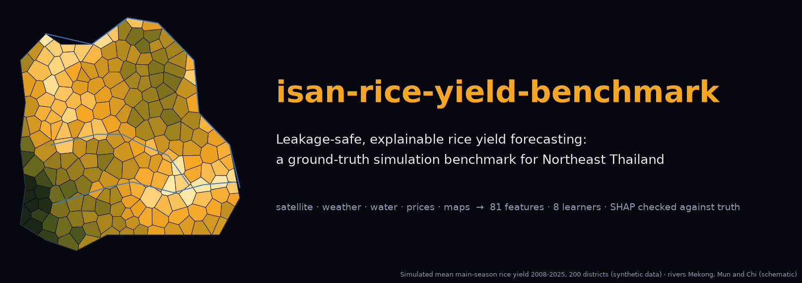
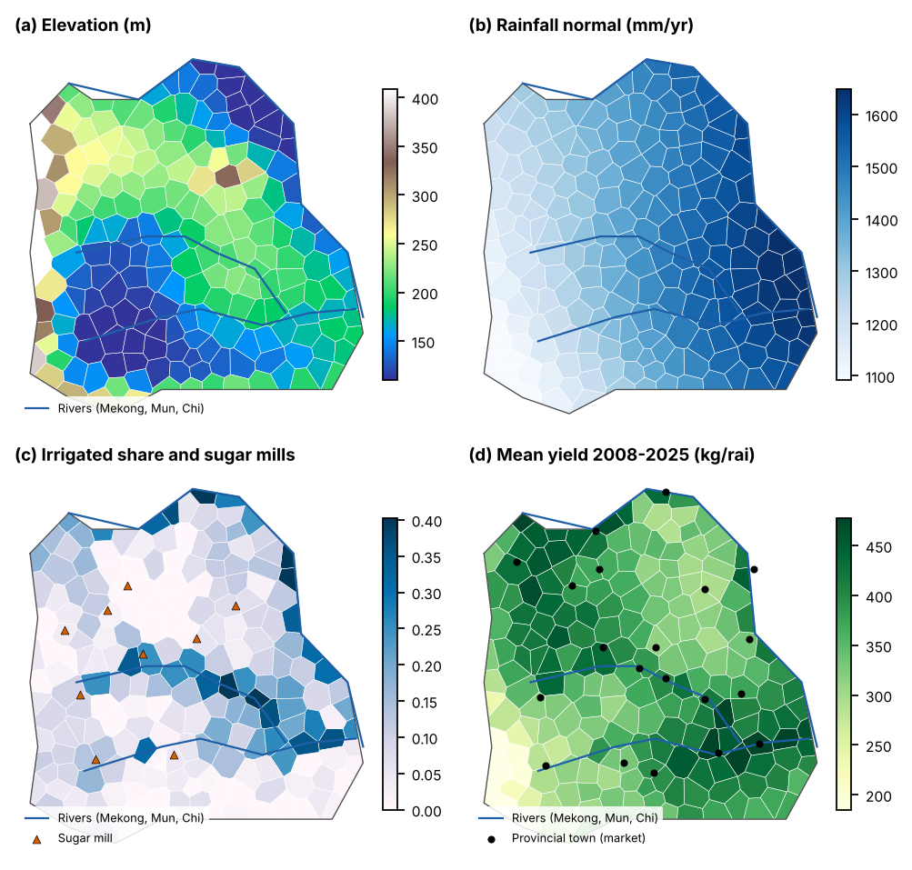

<p align="center"><a href="paper/paper.pdf"></a></p>

<p align="center">
<a href="https://github.com/thanatchon36/isan-rice-yield-benchmark/actions/workflows/ci.yml"></a>
<a href="pyproject.toml"></a>
<a href="https://thanatchon36.github.io/isan-rice-yield-benchmark/paper/"></a>
<a href="paper/paper.pdf"></a>
<a href="docs/DATA_SCHEMA.md"></a>
<a href="LICENSE"></a>
<a href="https://zenodo.org/badge/latestdoi/1449352537"></a>
<a href="https://huggingface.co/datasets/thanatchon36/isan-rice-yield-benchmark"></a>
</p>

<p align="center">
📖 <b><a href="https://thanatchon36.github.io/isan-rice-yield-benchmark/paper/">Read the paper online</a></b> ·
📄 <b><a href="paper/paper.pdf">Download the PDF</a></b> ·
🗂️ <b><a href="docs/DATA_SCHEMA.md">Data schema</a></b> ·
🤗 <b><a href="https://huggingface.co/datasets/thanatchon36/isan-rice-yield-benchmark">Dataset</a></b>
</p>

**Leakage-safe, explainable multi-source machine learning for district-level rice yield forecasting: a ground-truth
simulation benchmark for Northeast Thailand.** A process-informed simulator of main-season rice in 200 districts of
Isan over 18 seasons stores the true yield components next to the observations, so the pipeline can be checked twice:
are the forecasts accurate under a leakage-safe protocol, and do the explanations recover the mechanisms that really
generated the yields?

> **Synthetic data notice.** Everything in `data/raw/` comes from a documented data-generating process (DGP), not
> from Thai statistics. The results are methodological findings about forecasting pipelines, not empirical statements
> about Thai rice yields. `docs/DATA_SCHEMA.md` gives the schema for real data; drop the files in and run `make all`.

## Install and quickstart

```bash
make setup      # uv venv + dependencies (Python 3.12)
make all        # tests -> experiments -> diagnostics -> figures -> map -> paper   (about 8 minutes, 1 CPU)
make test       # leakage, determinism and shape tests
make quick      # smoke test of E1-E7 with tiny settings -> results_quick/
```

Outputs: `results/` (metrics, predictions, ablations, SHAP recovery, conformal coverage, robustness),
`paper/tables/` and `paper/figures/` (generated), `paper/paper.pdf` and the web reader `docs/paper/`.

| Target | Purpose |
|---|---|
| `simulate` | Simulate the main world → `data/raw/` (synthetic inputs plus the true yield components) |
| `experiments` | E1-E7 → `results/`; cached and resumable (`python -m isanrice.cli experiments --only e3 --force`) |
| `diagnostics` | Post-hoc diagnosis of the Ridge failures, in the main world and three others |
| `figures` | Figures, LaTeX tables and `paper/tables/macros.tex`, with an automatic text-overlap check |
| `map` | Study-area map of the paper (downloads Natural Earth boundaries into `data/external/`) |
| `paper` | `paper/paper.pdf` (tectonic) and the web reader `docs/paper/` (pandoc) |
| `web` | Web reader only → `docs/paper/index.html`, served at <https://thanatchon36.github.io/isan-rice-yield-benchmark/paper/> |
| `arxiv` | arXiv source bundle → `paper/arxiv.tar.gz` (prints title, abstract and comments for the form) |
| `dataset` | Stage the Hugging Face dataset → `build/hf_dataset/` (`UPLOAD=1` also uploads it) |
| `banner` | README banner → `docs/assets/banner.png` |
| `poster` | LinkedIn poster → `docs/assets/linkedin_poster.png` |

## What the pipeline does

1. **Simulator** (`isanrice.simulate`): 200 districts × 18 seasons (2008-2025) with drought, flood, heat, disease,
   salinity, price and competing-crop (cassava, sugarcane, maize) effects, persistent management and satellite-only
   pest outbreaks. It emits weather, cloud-contaminated satellite indices (NDVI, EVI, LSWI, LST), prices, reservoir
   storage and noisy map layers, and stores each mechanism's true contribution to every yield.
2. **Features** (`isanrice.features`): 81 leakage-safe features in 8 groups (history, moisture, water, climate,
   satellite, prices, geography, map/spatial lags), plus deliberately leaky variants for the audit.
   `tests/test_pipeline.py` perturbs every future observation and fails if any feature for an earlier season moves.
3. **Learners** (`isanrice.models`): persistence, climatology, panel fixed effects, Ridge, random forest, MLP,
   LightGBM and a LightGBM + Ridge ensemble, tuned on 2015-2017 only.
4. **Evaluation** (`isanrice.evaluation`, `isanrice.experiments`): rolling origin over the test seasons 2018-2025
   (season *t* is trained on seasons before *t*), season-block bootstrap, Diebold-Mariano (HLN) with Holm correction,
   rolling conformal intervals and grouped SHAP.
5. **Experiments**: E1 accuracy, E2 leakage audit, E3 feature-group ablation, E4 ground-truth recovery of SHAP,
   E5 in-season forecasting from July, E6 conformal intervals, E7 robustness (10 replicate worlds, 4 scenarios).
6. **Paper**: every number, table and figure is written by `isanrice.figures` from `results/`, so `make all`
   regenerates the manuscript end to end.

## Key findings (synthetic benchmark, test seasons 2018-2025)

| Topic | Result |
|---|---|
| Accuracy | LightGBM RMSE 27.4 kg/rai vs. climatology 47.1 (-42%); replicated in 10 worlds |
| Leakage | random cross-validation understates error by 10-21% and hides model failures |
| Inner-loop leakage | row-wise LOO tuning of Ridge caused catastrophic seasons (post-hoc finding) |
| Satellite | only feature group whose removal matters (+25% RMSE); value appears from October |
| Explanations | SHAP recovers drought (r = 0.84) but misattributes heat and absorbs the trend into prices |
| Uncertainty | 80% conformal intervals cover 78.3% of outcomes |

## Research: *Leakage-safe, explainable multi-source machine learning for district-level rice yield forecasting*

The preprint by Thanatchon Chongmankhong is in [`paper/`](paper/): a PDF in [`paper/paper.pdf`](paper/paper.pdf), its
LaTeX source in [`paper/main.tex`](paper/main.tex) and [`paper/sections/`](paper/sections/), and a web version at
<https://thanatchon36.github.io/isan-rice-yield-benchmark/paper/>, rendered from the same source by pandoc with the
PDF's numbering. `make arxiv` packs the source, `main.bbl` and the figures it uses into `paper/arxiv.tar.gz` and
checks that the bundle compiles on its own.

- Tables: [`paper/tables/`](paper/tables/) · Figures: [`paper/figures/`](paper/figures/)
- Dataset on Hugging Face: [`thanatchon36/isan-rice-yield-benchmark`](https://huggingface.co/datasets/thanatchon36/isan-rice-yield-benchmark),
  with the simulated main world, its true yield components and the experiment results

<p align="center"></p>

## Repository layout

```
src/isanrice/
  config.py                 study design (crop, region, seasons, validation years, feature groups) and paths
  simulate.py               data-generating process + true components + scenarios
  features.py               leakage-safe feature engineering (+ deliberately leaky variants for the audit)
  models.py                 learners (panel FE, Ridge, RF, MLP, LightGBM, ensemble)
  evaluation.py             rolling origin, random-CV audit, metrics, season bootstrap, DM-HLN + Holm, conformal, SHAP
  experiments.py            E1-E7 (cached, resumable)
  diagnostics.py            post-hoc diagnosis of the Ridge failures (exploratory)
  diag_worlds.py            same diagnosis in other worlds
  figures.py                figures, LaTeX tables and paper/tables/macros.tex
  figcheck.py               automatic check that no text overlaps in any figure
  paper_build.py            paper/main.tex -> paper/paper.pdf (tectonic)
  paper_web.py              paper/main.tex -> docs/paper/index.html (pandoc, LaTeX numbering)
  cli.py                    python -m isanrice.cli {simulate,experiments,diagnostics,figures,paper,web}
scripts/thailand_map.py     study-area figure (--paper) and standalone maps (Natural Earth, UTM 47N)
scripts/gee_extract.py      Google Earth Engine template for real MODIS / CHIRPS / ERA5-Land / SRTM inputs
scripts/arxiv_bundle.py     arXiv source bundle
scripts/hf_dataset.py       Hugging Face dataset card + upload
scripts/make_banner.py      README banner
scripts/make_linkedin_poster.py  LinkedIn poster
data/raw/                   synthetic inputs (same schema as real data)
results/                    experiment outputs (CSV/JSON)
paper/                      main.tex, sections/, tables/, figures/, reader.html, paper.pdf
docs/                       data schema, internal review, references to verify, web reader (GitHub Pages)
tests/                      leakage, determinism and shape tests
```

## Going from synthetic to real

1. Run `scripts/gee_extract.py` with your Earth Engine account and district polygons
   (`uv pip install -e ".[gee]"`), then `--split` the exports into `data/raw/`.
2. Add yields, prices, reservoir storage and map layers following `docs/DATA_SCHEMA.md`.
3. `make all`. E4 checks explanations against the simulated truth and has no real-data counterpart.

## Limitations

Synthetic data throughout; one region and one crop; the DGP decides which mechanisms exist and how strong they are,
so the ranking of learners and feature groups is a property of this benchmark. The references were compiled without
database access and are listed for checking in `docs/references_to_verify.md`; `docs/review.md` holds an internal
review. See the paper's discussion.

## Citation

See [`CITATION.cff`](CITATION.cff); each release is archived on Zenodo (concept DOI [10.5281/zenodo.24036674](https://doi.org/10.5281/zenodo.24036674), badge above). License: MIT (code); the synthetic dataset on Hugging Face is CC BY 4.0.
Developed with the assistance of Claude (Anthropic).
